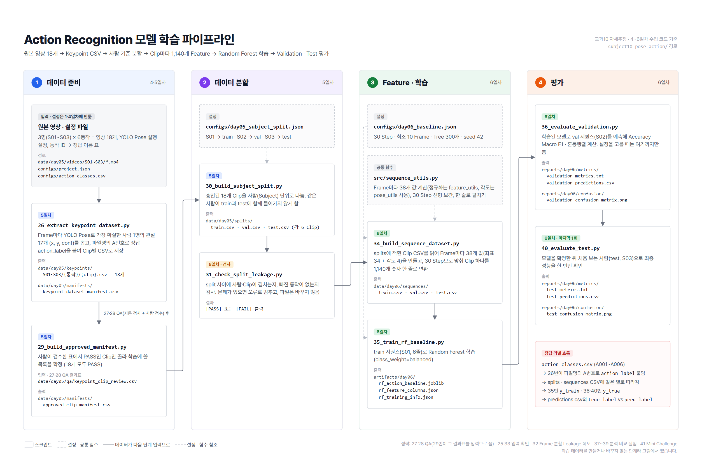

# Subject 10 - Pose Estimation & Action Analysis

교과 10 자세추정 이론·실습 프로젝트입니다.

## 실행 준비

```bash
cd ~/ai_vision/subject10_pose_action
uv sync
source .venv/bin/activate
```

## 데이터 (Git에 올리지 않음)

강사님 저장소 [handgonpo/Vision_AI_Class](https://github.com/handgonpo/Vision_AI_Class)의 `교과10 자세추정/10일 수업/` 아래 `N일차 데이터/`에서 받아 넣습니다.

| 위치 | 넣을 파일 |
|---|---|
| `data/day01/` | `coco8-pose.zip` (압축 풀기: `python -m zipfile -e data/day01/coco8-pose.zip data/day01/coco8_pose`) |
| `data/day01/video/` | `solution_ci_pose_demo.mp4` |
| `data/day02/images/` | `front.jpg` `arms_up.jpg` `side.jpg` `partial_body.jpg` `occlusion.jpg` `distance_far.jpg` |
| `data/day02/videos/` | `pose_quality_demo.mp4` (= day01 영상 복사본) |
| `data/day04/videos/` | `4일차 데이터/` 의 6개 MP4 |
| `data/day05/videos/S01~S03/` | `5일차 데이터/S01~S03/` 의 18개 MP4 (`S01_A001_T01.mp4` …) — 6일차도 이 데이터 사용 |

`yolo11n-pose.pt`는 첫 실행 때 Ultralytics가 자동으로 받습니다.

## Day 01 - Pose 전체 구조·개발환경·실제 데이터 입력

### 사용한 입력

- COCO8-Pose
- Ultralytics Pose Demo MP4
- 스마트폰 IP Webcam 캡처 이미지

### 학습한 내용

- Pose Estimation과 Action Recognition의 차이
- WSL 프로젝트와 Python 가상환경 구성
- OpenCV / PyTorch / Ultralytics 확인
- GPU / CUDA 확인
- COCO8-Pose 이미지 입력
- YOLO Pose 추론
- Person Bounding Box
- COCO 17 Keypoint
- Skeleton
- 실제 MP4 Frame 처리
- MP4 Frame별 Pose
- IP Webcam 연결 및 Frame 저장
- 직접 촬영 이미지 Pose 추론

### Day 01 Pipeline

```text
JPG / MP4 / IP Webcam
        ↓
Frame
        ↓
YOLO Pose
        ↓
Person Bounding Box
        ↓
COCO 17 Keypoint
        ↓
Skeleton
```

### 주요 실행 파일

```text
scripts/
├── 00_check_environment.py
├── 01_image_input.py
├── 02_video_input.py
├── 03_pose_image.py
├── 04_pose_video.py
└── 05_ip_webcam_capture.py
```

### 주요 결과

- `reports/day01/environment.txt`
- COCO8-Pose 이미지 Pose 결과
- `reports/day01/pose_demo_output.mp4`
- IP Webcam 촬영 이미지 Pose 결과

### 다음 수업

2일차에는 Keypoint 좌표와 Confidence를 자세히 읽고,
촬영 조건에 따라 Pose 품질이 어떻게 달라지는지 분석합니다.

## Day 02 - Keypoint 좌표와 Pose 품질 분석

### 오늘 사용한 입력

- 강사가 준비한 조건별 이미지 6장
  - `front.jpg`
  - `arms_up.jpg`
  - `side.jpg`
  - `partial_body.jpg`
  - `occlusion.jpg`
  - `distance_far.jpg`
- 1일차에서 사용한 실제 MP4
- Team Mini Challenge 직접 촬영 이미지

### 오늘 학습한 내용

- Person BBox Confidence와 Keypoint Confidence 구분
- COCO 17 Keypoint Pixel 좌표 확인
- Normalized 좌표 이해
- Keypoint Confidence와 Threshold 이해
- Confidence 기준에 따른 Skeleton 표시
- 여러 이미지의 Pose 품질 CSV 비교
- BBox Area Ratio 비교
- 평균 Keypoint Confidence와 LOW 관절 확인
- MP4의 Frame별 Pose 품질 분석
- 불안정한 Frame을 숫자로 찾고 실제 영상과 연결
- 촬영 조건 하나를 바꾸어 Pose 품질 비교

### 실제 실습에서 확인한 결과

`09_compare_pose_images.py` 실행 결과 (yolo11n-pose, RTX 3060):

| 이미지 | BBox 비율 | 평균 Keypoint Conf | LOW 관절 |
|---|---:|---:|---:|
| front.jpg | 0.300 | 0.975 | 0 |
| arms_up.jpg | 0.675 | 0.960 | 0 |
| distance_far.jpg | 0.149 | 0.971 | 0 |
| occlusion.jpg | 0.265 | 0.953 | 1 |
| partial_body.jpg | 0.339 | 0.907 | 2 |
| side.jpg | 0.199 | 0.754 | 4 |

- `side.jpg`가 6장 중 가장 불안정 (좌·우 관절이 겹침)
- `front.jpg` VS `distance_far.jpg`: 화면상 크기는 크게 줄었지만 평균 Confidence는 `0.975 → 0.971`로 유지
- MP4 Frame 분석: 60개 Frame 모두 사람 검출, 약 0.80초(25~26번 Frame)에서 얼굴 주변 Keypoint Confidence가 낮아짐

### Day 02 Pipeline

```text
이미지 · MP4
        ↓
YOLO Pose
        ↓
Person BBox
+
COCO 17 Keypoint
        ↓
Pixel / Normalized 좌표
        ↓
Keypoint Confidence
        ↓
Threshold
        ↓
조건별 Pose 품질 비교
        ↓
Frame별 Pose 품질 분석
        ↓
숫자와 실제 이미지·영상 연결
```

### 주요 실행 파일

```text
scripts/
├── 06_check_day02_data.py
├── 07_pose_image_detail.py
├── 08_draw_skeleton_quality.py
├── 09_compare_pose_images.py
└── 10_pose_video_quality.py

src/
└── pose_utils.py
```

### 주요 결과 파일

```text
reports/day02/tables/
├── front_keypoints.csv
├── image_quality_summary.csv
├── pose_quality_demo_frame_quality.csv
└── pose_quality_demo_keypoints.csv

reports/day02/challenge/
└── challenge_notes.md
```

### 다음 수업

3일차에는 2일차에서 확인한 Keypoint를 이용하여
관절각도와 정규화된 Frame Feature를 만듭니다.

## Day 03 - Joint Angle, Normalization & Frame Feature

### 오늘 배운 내용

- 세 Keypoint로 관절각도 계산 (팔꿈치·무릎 좌우 4개)
- Hip Center 기준 몸 중심 이동 + Shoulder Width 기준 크기 정규화
- Near / Far, Person A / Person B 정규화 전·후 비교
- COCO Left / Right 기준과 Keypoint 좌우 반전
- 34개 Normalized 좌표 + 4개 관절각도 = **38-D Frame Feature**
- 동작을 설명하는 Feature 선택 (Arms Up: 손목 y − 어깨 y)
- 영상의 각 Frame에서 38-D Feature 생성 → 시간에 따른 변화 확인

### Day 03 핵심 흐름

```text
YOLO Pose → COCO 17 Keypoint + Confidence → 관절각도
→ Hip Center → Shoulder Width Normalization
→ Normalized 34 + Angle 4 = 38-D Frame Feature
→ 영상의 각 Frame에 반복 → Sequence의 재료
```

### 오늘 추가한 주요 코드

```text
src/feature_utils.py
scripts/11_check_day03_data.py ~ 18_video_frame_features.py
```

### 실행 결과 (11/16)

| 항목 | 결과 |
|---|---|
| 12 관절각도 (arms_up_person_a) | 팔꿈치 L/R 132.50° / 125.38°, 무릎 174.53° / 173.54° |
| 12 관절각도 (sit_pose) | 무릎 L/R 97.88° / 117.49° |
| 14 Near vs Far | 픽셀 평균거리 131.05 → 정규화 0.1435 |
| 14 Person A vs B | 69.40 → 0.3385 |
| 15 좌우 반전 | Left vs Right 0.6086 → 반전 후 0.1207 |
| 16 Frame Feature | 38개, 평균 Confidence 0.957 |
| 17 Arms Up | person_a True / **sit_pose도 True (오탐)** |
| 18 영상 Feature | 60 Frame 중 60 Valid, 왼팔꿈치 140.14° → 115.62° |

- 처음 받은 교재의 `18_video_frame_features.py` 코드 칸에는 17번 코드가 잘못 들어가 있어서
  교재 설명·결과에 맞춰 직접 작성했었음. 11/19 수정 교재의 18번 코드로 바꾸고 다시 실행 →
  60 Frame·38개 Feature 값이 직접 작성본과 같음 (직접 작성본에만 있던 hip_center_x·y, shoulder_width 3열은 빠짐).
- Arms Up 규칙(손목이 어깨보다 위)은 앉은 자세에서도 True가 나옴 →
  Feature 한두 개로 만든 규칙은 쉽게 오탐하므로 Sequence·학습 모델이 필요한 이유.

### 오늘 이해한 핵심

Keypoint 좌표를 그대로 쓰지 않고 몸의 위치·크기 차이를 줄인 Normalized 좌표와 관절각도로
한 Frame의 자세를 38개의 숫자로 표현했다. 동작 구분에는 38개를 전부 보는 것보다
그 동작을 설명하는 Feature를 고르는 것이 중요하다.

### Mini Challenge (3팀, Sit vs Stand 정면)

3팀 금요일 녹화 영상 `T03_S01_A07_T01_F`(매트에 앉기)를 다시 써서 12·14·16·18번을 수행.
Far 사진은 같은 Frame을 50%로 줄여 만듦. 결과: [reports/day03/challenge/feature_design.md](reports/day03/challenge/feature_design.md)

| 항목 | 결과 |
|---|---|
| 12 관절각도 | 무릎 L/R Sit 124° / 78° · Stand 173° / 175° |
| 14 Near vs Far (Sit) | 픽셀 124.99 → 정규화 0.206 (접힌 다리를 작은 화면에서 다르게 찾음) |
| 선택한 Feature | 무릎 각도 평균, knee_y, ankle_y |
| 18 영상 (615 Frame) | knee_y 서 있음 1.06 → 앉아 유지 0.10 → 다시 1.08 |

- 무릎 각도는 해석이 쉽지만 양반다리에서 좌우가 다르고 많이 흔들림(유지 구간 std 15.7°).
  정규화된 무릎·발목 높이가 Near/Far·유지 구간 모두 가장 안정적.

### 팀 프로젝트 (3팀, 무인 상점 이상행동)

4일차 STEP 1~5(Manifest, 영상 검사, 136개 Sequence, 몸 크기 정규화, QA 요약)를 여기서 시작했고,
2026-11-17 별도 저장소 [unmanned-store-anomaly](https://github.com/wlgptjd333/unmanned-store-anomaly)로 옮겼습니다.
이전 기록은 커밋 `b3d6c32`, `3e0e9a5`에 있습니다.

### 다음 수업

4일차에는 여러 Frame의 Feature를 시간 순서로 묶어 하나의 동작을 표현하는 **Sequence**로 확장한다.

## Day 04 - Action Clip을 Sequence 데이터로 만들기

한 사람의 6개 동작 영상(bend_return, leg_raise_lower, walk_turn_walk, drink_return, sit_stand, wave)을
Frame마다 38-D Feature로 바꾸고 시간 순서로 묶어 동작 하나 = Sequence 하나로 저장했습니다.

| 항목 | 결과 |
|---|---|
| 영상 | 6개, 25fps, 85~266 Frame |
| Pose 성공 | 6개 모두 100%, 평균 Confidence 0.89~0.97 |
| Frame 간 Feature 변화 평균 | 0.10~0.22, **walk_turn_walk 만 17.48** (교재 17.18) |

- walk_turn_walk 는 몸을 돌리는 순간 어깨가 겹쳐 어깨 폭이 0 에 가까워지고, 그걸로 나눈 정규화 값이 튑니다.
  3팀 측면 영상에서 본 현상과 같아서, 3팀은 몸 크기 정규화를 따로 만들었습니다.
- 코드: `scripts/19_check_day04_data.py` ~ `24_inspect_sequence_stages.py`, 결과: `reports/day04/tables/`

## Day 05 - 18개 Action Clip을 Keypoint Dataset으로 만들고 Subject-wise Split

강사님 제공 18개 MP4(3명 × 6동작)를 원본 Keypoint Dataset → 자동 QA → Human QA → Approved → 사람 단위 Split 으로 처리했습니다.
요약: [reports/day05/day05_summary.md](reports/day05/day05_summary.md)

```text
25 영상 검사 → 26 YOLO Keypoint(Pixel·Image Normalized·Confidence) → 27 자동 QA
→ 28 Human QA 확인 → 29 Approved Manifest → 30 Subject-wise Split → 31 Leakage 검사
→ 32 Frame 무작위 분할의 Leakage 체험
```

| 항목 | 결과 |
|---|---|
| 자동 QA | AUTO_PASS 13 · CHECK 5 (S02 A001~A005, 교재와 같음) |
| CHECK 원인 | 오른쪽 옷걸이의 외투를 사람으로 검출 (conf 0.26~0.72) → 실제 1명, 동작 정상 |
| Human QA | 18개 모두 장면 확인 후 PASS (근거는 `human_note`) |
| Split | Train S01 · Validation S02 · Test S03 (각 6개, 6동작 모두) |
| Leakage | Subject·Clip 겹침 없음 / Frame 무작위 분할은 18개 Clip 모두 겹침 |

- 교재 설명은 AUTO_PASS 를 UNREVIEWED 로 둬도 된다고 하지만, 교재 28·29번 코드는 PASS 만 승인합니다.
  그래서 교재 23.7 대로 18개 전부 사람이 확인해 PASS 로 기록했습니다.

## Day 06 - Action Recognition Baseline 성능평가

길이가 다른 Clip 을 30단계로 보간해 30 × 38 = 1,140개 Feature 로 만들고 Random Forest 로 6개 동작을 분류했습니다.
요약: [reports/day06/day06_summary.md](reports/day06/day06_summary.md) · Mini Challenge: [reports/day06/challenge/mini_challenge_result.md](reports/day06/challenge/mini_challenge_result.md)

| 실험 | Validation S02 (이 PC) | 교재 |
|---|---:|---:|
| Baseline (30 Step, 좌표 + 각도) | 0.5000 (3/6) | 0.6667 |
| Static (가운데 Frame 1개) | 0.6667 | 0.6667 |
| 좌표만 (각도 제외) | 1.0000 | 1.0000 |
| Mini Challenge: 15 Step | 0.6667 | — |
| **Test S03 (마지막 1회)** | **1.0000 (6/6)** | — |

- 오분류는 walk_turn_walk → leg_raise_lower, drink_return ↔ wave (팔을 머리 높이로 올리는 동작끼리). 확신도 0.21~0.23.
- **교재와 다른 이유:** Train 이 6개뿐이라 Random Forest 난수(`random_state`)만 0~19 로 바꿔도
  Validation 이 0.50~1.00 (평균 0.78) 으로 흔들립니다. 교재 0.67 과 이 PC 0.50 모두 이 범위 안입니다.
- 그래서 Static·각도 제외·15 Step 이 "낫다"고 결론 내리지 않고 Baseline 설정을 유지했습니다.
  같은 비교를 3팀 170개 영상으로 하면 Sequence 가 Static 보다 분명히 높습니다(74% vs 57%).

```bash
python scripts/33_check_day06_inputs.py
python scripts/34_build_sequence_dataset.py
python scripts/35_train_rf_baseline.py
python scripts/36_evaluate_validation.py
python scripts/37_analyze_misclassified.py
python scripts/38_compare_static_vs_sequence.py
python scripts/39_compare_feature_sets.py
python scripts/41_day06_mini_challenge.py   # Mini Challenge + 난수 민감도 (Test 안 씀)
python scripts/40_evaluate_test.py          # Test 는 마지막에 한 번
```

### 4~6일차 모델 학습 파이프라인



앞 단계의 출력이 다음 단계의 입력이 되는 순서대로 그렸습니다 (26 → 29 → 30 → 31 → 34 → 35 → 36 → 40).
29번은 27·28 QA 결과표에서 PASS만 골라 학습 목록을 만들고, 31번은 split 겹침을 검사해 문제가 있으면 멈춥니다.
27·28 QA, 25·33 입력 확인, 32 데모, 37~39 비교 실험, 41 Mini Challenge 는 학습 데이터를 만들거나 바꾸지 않아서 뺐습니다.
원본은 draw.io 로 열 수 있습니다: [docs/day04-06_training_pipeline.drawio](docs/day04-06_training_pipeline.drawio)

### 다음 수업

7일차에는 실시간 Frame 을 모아 Sliding Window 를 만들고 실시간 Action Recognition 으로 연결한다.
